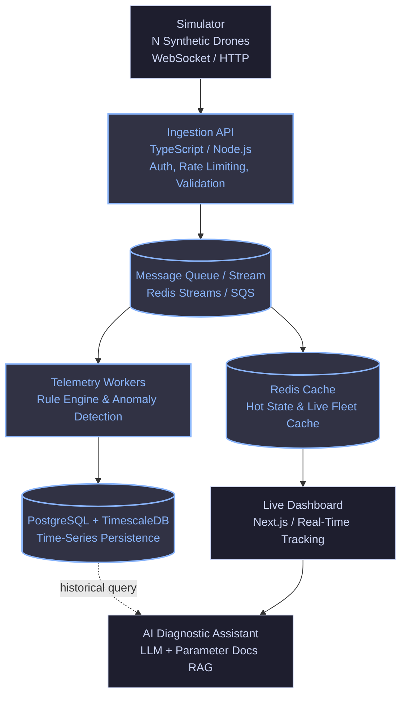

# 🛰️ AeroStream

> **High-Throughput Real-Time Drone Fleet Telemetry & Anomaly Diagnostics Platform**

[](https://www.typescriptlang.org/)
[](https://nodejs.org/)
[]()
[](https://opensource.org/licenses/MIT)

---

## 📌 Overview

**AeroStream** is a distributed, event-driven telemetry and monitoring platform designed to ingest, process, and analyze high-frequency metrics from autonomous drone fleets in real time. 

Operating under simulated mission conditions, the platform ingests positioning (GPS), battery status, sensor health, and satellite connectivity from hundreds of concurrent drones, validating operational constraints with sub-100ms latency, caching hot state, storing time-series data for historical playback, and providing LLM-driven post-flight diagnostic reports.

---

## 🏛️ System Architecture



### Core Architecture Components

1. **Synthetic Drone Fleet Simulator:** Generates realistic mission telemetry (GPS coordinates, battery levels, satellite count, pitch/roll, and telemetry anomalies).
2. **Ingestion API:** High-throughput entry point responsible for request validation, token authentication, and tenant rate-limiting.
3. **Queue & Stream Buffer (Redis Streams):** Decouples ingestion from processing to handle sudden traffic spikes without packet drop.
4. **Processing Workers:** Evaluates domain rules (e.g., GPS satellite count < 20, battery discharge anomalies, geofence breaches) and generates structured alerts.
5. **Hot State Cache (Redis):** Sub-millisecond store containing the current live position and status of every active drone.
6. **Time-Series Store (PostgreSQL + TimescaleDB):** Optimized hypertable storage for historical mission analytics and telemetry replay.
7. **Fleet Dashboard:** Real-time visual monitoring with interactive maps, telemetry graphs, and mission playback.
8. **AI Flight Diagnostics:** LLM-powered assistant with RAG over drone telemetry parameter guides to explain flight anomalies and recommend maintenance.

---

## 🛠️ Tech Stack & Engineering Rationale

| Layer | Technology | Primary Rationale |
| :--- | :--- | :--- |
| **Language** | TypeScript (Node.js 24+) | Strict type safety across contracts, high async I/O performance |
| **Ingestion & Services** | Modular Architecture | Clean separation of concerns, lightweight footprint |
| **Streaming / Queue** | Redis Streams | In-memory latency (<5ms), consumer groups, trivial local orchestration |
| **Hot Cache** | Redis | Instant spatial and status lookup for live fleet dashboards |
| **Time-Series DB** | PostgreSQL + TimescaleDB | Relational integrity with optimized hypertables and chunk compression |
| **Observability** | OpenTelemetry, Prometheus, Grafana | Distributed tracing across ingestion and worker stages |
| **Load Testing** | k6 | Quantifiable p95 latency and stress benchmarking |
| **IaC & Deploy** | Docker Compose / Terraform (AWS) | Reproducible local setups and automated cloud provisioning |

---

## 📂 Repository Structure

```text
aerostream/
├── .github/              # CI/CD Workflows, PR and Issue templates
│   ├── ISSUE_TEMPLATE/   # Bug report and feature request templates
│   └── pull_request_template.md
├── apps/
│   ├── api/              # Ingestion API service
│   ├── simulator/        # Synthetic drone telemetry generator
│   ├── workers/          # Stream consumer and rule engine
│   └── web/              # Live dashboard (Next.js)
├── packages/
│   └── shared-types/     # Shared domain interfaces and schemas
├── docs/
│   ├── adr/              # Architecture Decision Records
│   └── specs/            # Project specifications and benchmarks
├── docker-compose.yml    # Local multi-service infrastructure
├── CONTRIBUTING.md       # Development guidelines and commit standards
└── README.md
```

---

## 🚦 Roadmap

- [x] **Fase 0: Repositório & Governança:** Padrões de commit, templates de PR/Issue e setup de ADRs.
- [x] **Fase 1: Fundação:** Simulador sintético, Ingestion API, PostgreSQL (TimescaleDB) e testes de integração com Docker Compose.
- [ ] **Fase 2: Tempo Real:** Ingestão desacoplada por Redis Streams, workers de regras e dashboard ao vivo com replay de voo.
- [ ] **Fase 3: Cloud & Observabilidade:** Deploy com Terraform (AWS), instrumentação OpenTelemetry + Prometheus/Grafana e testes de carga com k6.
- [ ] **Fase 4: IA Aplicada:** Assistente de diagnóstico com RAG e LLM analisando anomalias de voo.
- [ ] **Fase 5: Fechamento & Segurança:** Hardening OWASP, simulação de falha controlada (post-mortem) e documentação final de métricas.

---

## ⚡ Quickstart / Local Development

### Prerequisites
- Node.js >= 20
- Docker & Docker Compose

### 1. Clone & Install
```bash
git clone https://github.com/FelipeDorneles09/AeroStream.git
cd AeroStream
npm install
```

### 2. Start Infrastructure (TimescaleDB & Redis)
```bash
docker compose up -d
```

### 3. Run Platform Services
```bash
# Terminal 1: Ingestion API (Port 3001)
npm run dev:api

# Terminal 2: Stream Workers (Consumer Group)
npm run dev:workers

# Terminal 3: Synthetic Fleet Simulator
npm run dev:simulator

# Terminal 4: Web Dashboard (Port 3002)
npm run dev:web
```

### 4. Run Test Suites
```bash
npm test
```
- Interactive Swagger documentation: `http://localhost:3001/docs`
- Live Fleet Dashboard: `http://localhost:3002`

---

## 📚 Technical Documentation & ADRs

Comprehensive technical specifications and decisions are documented under [`docs/`](./docs/):

- **Architecture Overviews:**
  - [System Architecture & Sequence Flow](./docs/architecture/system-overview.md)
  - [Data Contracts & Schema Specification](./docs/architecture/data-contracts.md)
- **Architecture Decision Records (ADRs):**
  - [ADR-0001: Record Architecture Decisions](./docs/adr/0001-record-architecture-decisions.md)
  - [ADR-0002: Real-Time Telemetry Pipeline & Storage Strategy](./docs/adr/0002-telemetry-pipeline-and-storage.md)
  - [ADR-0003: Redis Streams Consumer Groups & Real-Time SSE Feed](./docs/adr/0003-redis-streams-consumer-groups-and-realtime-feed.md)
  - [ADR-0004: Real-Time Geospatial Dashboard Architecture (Leaflet & SSE)](./docs/adr/0004-realtime-geospatial-dashboard-leaflet-sse.md)

---

## 🤝 Contributing & Commit Convention

This project strictly follows [Conventional Commits](https://www.conventionalcommits.org/en/v1.0.0/). Please consult [`CONTRIBUTING.md`](./CONTRIBUTING.md) before submitting Pull Requests.

---

## 📄 License

This project is licensed under the MIT License - see the [LICENSE](./LICENSE) file for details.
