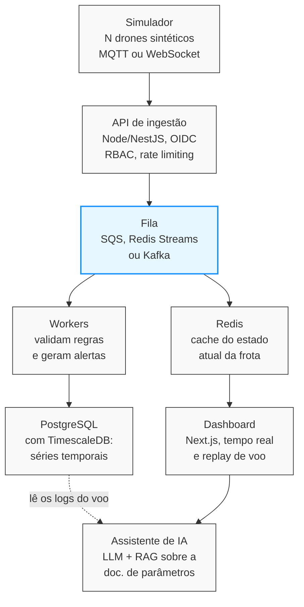
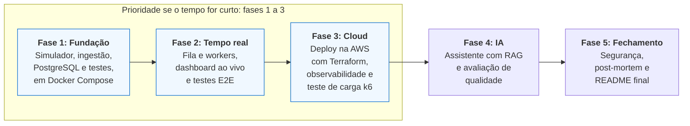

# Projeto de portfólio para engenheiro de software pleno (2027)

**Data:** Oct 21, 2026  
**Autor:** @Felipe Dorneles  

---

## Contexto e objetivo

Um único projeto de portfólio, aberto e bem documentado, pode cobrir as principais lacunas do currículo frente às vagas de pleno em 2027.

As lacunas que ele deve fechar, em ordem de prioridade:
- Cloud, containers e observabilidade
- System design com números e trade-offs, incluindo banco relacional em produção
- IA aplicada, além do uso de assistentes de código
- Testes além do básico: E2E e integração com banco
- Segurança
- Liderança técnica e colaboração

A proposta usa uma versão simulada do que o SkyCloud faz, com dados sintéticos. Ela não reaproveita código nem dados proprietários da empresa.

---

## Ideia principal: plataforma de telemetria de frota em tempo real

Um simulador gera telemetria de N drones (posição, bateria, satélites, alertas), e esse fluxo passa por ingestão, fila, processamento, armazenamento e dashboard ao vivo.

### Arquitetura da Plataforma (8 componentes)

*Os eventos entram pela API e esperam numa fila. Workers validam regras (por exemplo, satélites abaixo de 20) e gravam o resultado. O dashboard lê o estado atual do cache, e o assistente de IA lê os logs do voo para explicar anomalias.*

**Camadas base de infraestrutura:**
- **Observabilidade em todos os componentes:** OpenTelemetry, Prometheus e Grafana.
- **Entrega:** Terraform, AWS (ECS Fargate ou EKS) e GitHub Actions.

---

## Como o projeto cobre cada lacuna

Cada lacuna do currículo tem uma entrega concreta e verificável no projeto.

| Lacuna | O que entra no projeto |
| :--- | :--- |
| **Cloud e containers** | Docker Compose local, deploy na AWS (ECS Fargate ou EKS) com Terraform, CI/CD no GitHub Actions |
| **Observabilidade** | OpenTelemetry, Grafana e Prometheus, logs estruturados, alertas e um painel de custo |
| **System design** | Fila, cache, pub/sub, PostgreSQL relacional, decisões registradas em ADRs |
| **IA aplicada** | Assistente de diagnóstico: o LLM lê o log de um voo e explica anomalias, com RAG sobre a documentação de parâmetros e avaliação de qualidade |
| **Testes** | Unitários, integração com banco real (Testcontainers), E2E com Playwright, teste de carga com k6 |
| **Segurança** | Rate limiting, validação de entrada, gestão de segredos, checklist OWASP, scan de dependências no CI |
| **Colaboração** | Pull requests revisados por outra pessoa, issues organizadas, README claro, CONTRIBUTING |

---

## O que torna o projeto convincente

O que convence um recrutador são resultados medidos e decisões explicadas, não a lista de tecnologias.

- **Números reais:** o k6 mostra quantos eventos por segundo o sistema aguenta, a latência p95 e onde aparece o gargalo. *"Aguenta 2 mil eventos por segundo com p95 de 80 ms"* vale mais que uma lista de ferramentas. Os valores acima são exemplo de formato, não metas.
- **Um post-mortem:** derrube o sistema de propósito, ache o gargalo e documente a correção.
- **Diagrama de arquitetura e ADRs no README:** explicando por que você escolheu X em vez de Y.
- **Custo sob controle:** use free tier, escale a zero quando possível e documente quanto custa por mês, o que mostra FinOps na prática.
- **Colaboração real:** chame um colega ou alguém da comunidade para revisar PRs e cite isso no currículo.

---

## Alternativas mais focadas

Se o escopo da ideia principal parecer grande demais, estas duas opções cobrem menos lacunas, mas são mais rápidas de entregar.

1. **Serviço de planejamento de missão como API:** Recebe um polígono (parede ou telhado) e devolve o plano de voo. Usa fila e workers para jobs pesados, cache de resultados, cobrança por uso com Stripe e multi-tenancy. Cobre system design e backend e aproveita seu diferencial técnico, mas toca menos em cloud e IA.
2. **Analisador de logs com LLM:** Upload de logs, parser, regras automáticas, RAG sobre a documentação e relatório gerado, com avaliação das respostas. É o mais rápido de fazer e cobre IA e testes, mas cobre pouco de infraestrutura e escala.

---

## Roadmap em 5 fases

Cada fase termina com algo apresentável, e as fases 1 a 3 já cobrem cloud, system design e testes.

**Nota:** Se o tempo apertar, pare na fase 3 e deixe a IA como a última camada. As fases não têm datas: defina os prazos conforme o seu tempo disponível.

---

## Riscos e próximos passos

O maior risco é o escopo: um projeto tão amplo pode ficar pela metade. Se o tempo for curto, priorize as fases 1 a 3 do roadmap, que já cobrem cloud, system design e testes, e deixe a IA como a última camada.

**Próximos Passos:**
- [ ] Decidir entre a ideia principal e uma das alternativas
- [ ] Detalhar stack, estrutura de pastas e entregáveis de cada fase
- [ ] Escrever o primeiro ADR (escolha do banco e da fila)
- [ ] Combinar com alguém a revisão dos pull requests
- [ ] Preparar os bullets de currículo que o projeto vai gerar